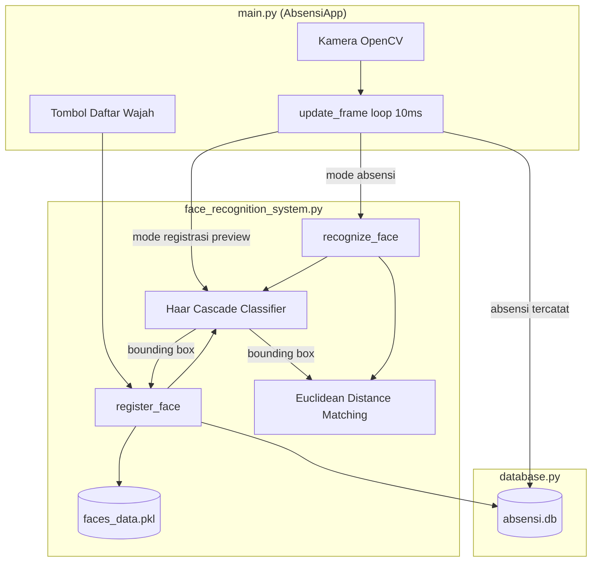
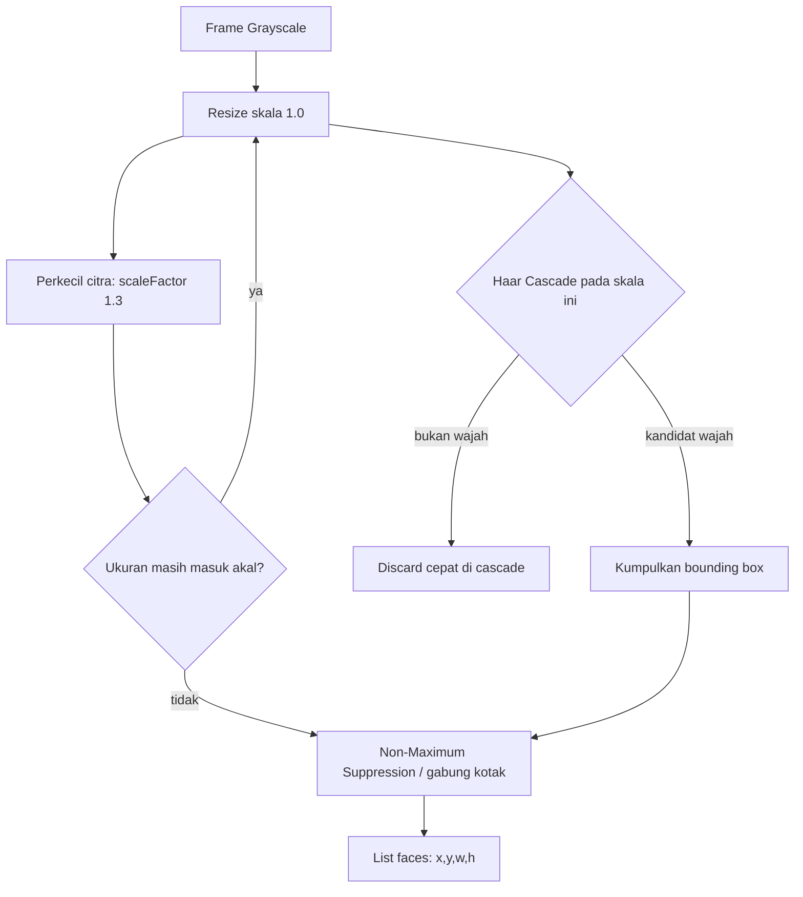
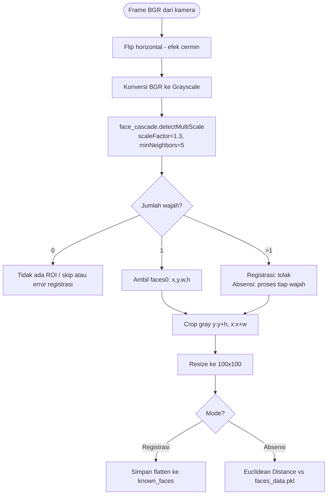
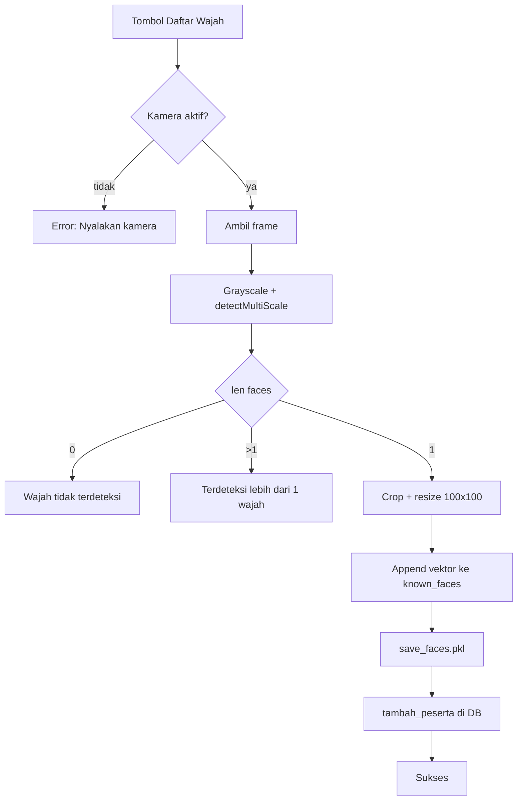
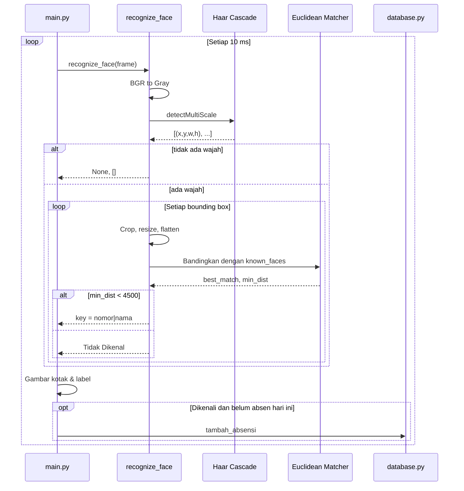
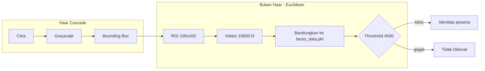

# Dokumentasi Haar Cascade Classifier pada Sistem Absensi Wajah

Dokumen ini menjelaskan secara rinci bagaimana algoritma **Haar Cascade Classifier** digunakan dalam proyek absensi berbasis pengenalan wajah ini: teori singkat, integrasi di kode, parameter yang dipakai, serta diagram alur untuk mode registrasi dan absensi.

---

## Daftar Isi

1. [Pengenalan Haar Cascade Classifier](#1-pengenalan-haar-cascade-classifier)
2. [Peran dalam Sistem Absensi Ini](#2-peran-dalam-sistem-absensi-ini)
3. [Implementasi di Kode Proyek](#3-implementasi-di-kode-proyek)
4. [Parameter detectMultiScale](#4-parameter-detectmultiscale)
5. [Diagram Alur Utama](#5-diagram-alur-utama)
6. [Alur Mode Registrasi](#6-alur-mode-registrasi)
7. [Alur Mode Absensi](#7-alur-mode-absensi)
8. [Dari Deteksi ke Pengenalan](#8-dari-deteksi-ke-pengenalan)
9. [Batasan dan Tips Penggunaan](#9-batasan-dan-tips-penggunaan)

---

## 1. Pengenalan Haar Cascade Classifier

### 1.1 Apa itu Haar Cascade?

**Haar Cascade Classifier** adalah metode deteksi objek klasik yang dikembangkan oleh Paul Viola dan Michael Jones (2001). Metode ini banyak dipakai untuk **mendeteksi wajah frontal** pada citra atau video dengan kecepatan relatif tinggi, tanpa memerlukan GPU atau model deep learning.

Konsep intinya:

| Konsep | Penjelasan |
|--------|------------|
| **Fitur Haar** | Pola persegi panjang pada citra (terang vs gelap) yang menyerupai bagian wajah: mata lebih gelap dari pipi, hidung lebih terang dari area sekitar, dll. |
| **AdaBoost** | Banyak fitur lemah digabung menjadi klasifier kuat yang membedakan “wajah” vs “bukan wajah”. |
| **Cascade** | Klasifier disusun berlapis (cascade). Citra yang jelas bukan wajah ditolak di lapisan awal; hanya kandidat yang lolos semua lapisan dianggap wajah. |

Dengan cascade, sebagian besar area citra yang bukan wajah dapat dibuang cepat, sehingga deteksi real-time pada webcam menjadi memungkinkan.

### 1.2 Apa yang dilakukan Haar Cascade di proyek ini?

Di sistem absensi ini, Haar Cascade **hanya bertugas mendeteksi lokasi wajah** (bounding box). Ia **tidak** mengidentifikasi siapa pemilik wajah.

```
┌─────────────────────────────────────────────────────────────┐
│  Pipeline pengenalan wajah di proyek ini                    │
├─────────────────────────────────────────────────────────────┤
│  1. Haar Cascade     →  Di mana wajah ada? (x, y, w, h)     │
│  2. Crop + resize    →  Potong ROI, ubah ke 100×100 px      │
│  3. Euclidean match  →  Cocokkan dengan data terdaftar      │
└─────────────────────────────────────────────────────────────┘
```

Pemisahan ini penting: Haar Cascade = **deteksi**; Euclidean Distance = **pengenalan/identifikasi**.

---

## 2. Peran dalam Sistem Absensi Ini

### 2.1 Model yang digunakan

Saat aplikasi dimulai, kelas `FaceRecognitionSystem` memuat classifier bawaan OpenCV:

```python
self.face_cascade = cv2.CascadeClassifier(
    cv2.data.haarcascades + 'haarcascade_frontalface_default.xml'
)
```

| Item | Nilai |
|------|--------|
| Berkas model | `haarcascade_frontalface_default.xml` |
| Lokasi | Paket OpenCV (`cv2.data.haarcascades`) |
| Orientasi wajah | **Frontal** (menghadap kamera) |
| Objek instance | `self.face_cascade` di `FaceRecognitionSystem` |

Model ini sudah dilatih sebelumnya; proyek ini **tidak melatih ulang** Haar Cascade.

### 2.2 Di mana Haar Cascade dipanggil?

| Konteks | File | Fungsi | Pemanggilan |
|---------|------|--------|-------------|
| Inisialisasi | `face_recognition_system.py` | `__init__` | Memuat XML cascade |
| Registrasi (simpan wajah) | `face_recognition_system.py` | `register_face()` | `detectMultiScale` + validasi 1 wajah |
| Absensi (pengenalan) | `face_recognition_system.py` | `recognize_face()` | `detectMultiScale` + loop per wajah |
| Preview registrasi (GUI) | `main.py` | `update_frame()` | `detectMultiScale` langsung untuk kotak oranye |

Semua pemanggilan deteksi memakai parameter yang sama: **`scaleFactor=1.3`**, **`minNeighbors=5`**.

### 2.3 Diagram posisi Haar Cascade dalam arsitektur



---

## 3. Implementasi di Kode Proyek

### 3.1 Prasyarat: citra grayscale

Haar Cascade di OpenCV bekerja pada citra **grayscale** (satu kanal intensitas). Setiap alur deteksi dimulai dengan:

```python
gray = cv2.cvtColor(frame, cv2.COLOR_BGR2GRAY)
```

Frame dari kamera berformat **BGR** (Blue-Green-Red). Konversi ke grayscale mengurangi dimensi data dan sesuai dengan cara kerja fitur Haar.

### 3.2 Pemanggilan deteksi

```python
faces = self.face_cascade.detectMultiScale(gray, 1.3, 5)
```

**Return value:** `faces` adalah array NumPy berisi nol atau lebih bounding box, masing-masing berbentuk `(x, y, w, h)`:

| Simbol | Arti |
|--------|------|
| `x`, `y` | Sudut kiri atas kotak wajah (piksel) |
| `w`, `h` | Lebar dan tinggi kotak |

### 3.3 Setelah deteksi: crop region of interest (ROI)

Untuk setiap wajah yang terdeteksi:

```python
face_roi = gray[y:y+h, x:x+w]
face_roi = cv2.resize(face_roi, (100, 100))
```

ROI diambil dari citra grayscale, lalu diubah ukuran ke **100×100 piksel** agar fitur perbandingan (Euclidean) konsisten antar frame dan antar sampel terdaftar.

---

## 4. Parameter detectMultiScale

OpenCV memanggil deteksi multi-skala karena wajah di kamera bisa tampak besar atau kecil tergantung jarak.

```python
detectMultiScale(gray, scaleFactor=1.3, minNeighbors=5)
```

### 4.1 scaleFactor = 1.3

| Aspek | Penjelasan |
|-------|------------|
| Fungsi | Mengontrol seberapa besar penurunan skala citra antar putaran pencarian |
| Nilai 1.3 | Setiap iterasi, ukuran citra dikali ~1/1.3 (sekitar 23% lebih kecil) |
| Efek nilai kecil (mis. 1.1) | Lebih banyak skala → deteksi lebih teliti, **lebih lambat** |
| Efek nilai besar (mis. 1.5) | Lebih sedikit skala → **lebih cepat**, risiko melewatkan wajah kecil |

### 4.2 minNeighbors = 5

| Aspek | Penjelasan |
|-------|------------|
| Fungsi | Jumlah deteksi bertetangga yang harus “setuju” agar satu kotak dianggap valid |
| Nilai 5 | Cukup ketat: mengurangi kotak palsu (false positive) |
| Efek nilai rendah | Lebih banyak deteksi, termasuk noise |
| Efek nilai tinggi | Lebih sedikit deteksi, bisa melewatkan wajah samar |

### 4.3 Diagram konseptual detectMultiScale



---

## 5. Diagram Alur Utama

Diagram berikut merangkum alur dari frame kamera hingga hasil deteksi Haar Cascade (tanpa membedakan mode dulu).



---

## 6. Alur Mode Registrasi

Registrasi membutuhkan **tepat satu wajah** dalam frame agar sampel tidak tercampur.

### 6.1 Dua jalur registrasi

1. **Preview live (mode Registrasi):** `main.py` memanggil `detectMultiScale` hanya untuk menggambar kotak oranye.
2. **Simpan data (tombol Daftar Wajah):** `register_face()` di `face_recognition_system.py` memanggil `detectMultiScale` lagi pada frame saat tombol diklik.

### 6.2 Diagram alur registrasi lengkap

```mermaid
sequenceDiagram
    participant U as Pengguna
    participant GUI as main.py
    participant HC as Haar Cascade
    participant FRS as FaceRecognitionSystem
    participant PKL as faces_data.pkl
    participant DB as SQLite

    U->>GUI: Pilih mode Registrasi
    U->>GUI: Mulai Kamera
    loop Setiap 10 ms
        GUI->>GUI: Baca frame, flip
        GUI->>HC: detectMultiScale(gray, 1.3, 5)
        HC-->>GUI: faces[]
        GUI->>GUI: Gambar kotak oranye jika ada wajah
    end

    U->>GUI: Isi No. Absen & Nama
    U->>GUI: Klik Daftar Wajah
    GUI->>FRS: register_face(frame, nama, nomor)
    FRS->>FRS: cvtColor BGR2GRAY
    FRS->>HC: detectMultiScale(gray, 1.3, 5)
    HC-->>FRS: faces[]

    alt len(faces) == 0
        FRS-->>GUI: False, Wajah tidak terdeteksi
    else len(faces) > 1
        FRS-->>GUI: False, Terdeteksi lebih dari 1 wajah
    else len(faces) == 1
        FRS->>FRS: Crop ROI, resize 100x100, flatten
        FRS->>PKL: Simpan ke known_faces[key]
        FRS-->>GUI: True, Registrasi berhasil
        GUI->>DB: tambah_peserta(nomor, nama)
    end
```



### 6.3 Keputusan validasi registrasi



**Rekomendasi operasional:** klik `Daftar Wajah` berulang (3–5 kali) dengan sedikit variasi posisi kepala agar Haar Cascade dan pencocokan Euclidean punya banyak sampel untuk orang yang sama.

---

## 7. Alur Mode Absensi

Pada mode absensi, Haar Cascade dipanggil di dalam `recognize_face()`, yang dipicu dari `update_frame()` setiap ~10 ms.

### 7.1 Diagram alur absensi (deteksi + pengenalan)

```mermaid
flowchart TD
    START([update_frame - mode absensi]) --> READ[Baca frame + flip]
    READ --> REC[recognize_face frame]

    subgraph Haar["Tahap Haar Cascade"]
        REC --> G[Grayscale]
        G --> DMS[detectMultiScale 1.3, 5]
        DMS --> Z{Ada wajah?}
        Z -->|tidak| RET1[Return None, []]
        Z -->|ya| LOOP[Untuk setiap x,y,w,h]
    end

    subgraph PerWajah["Tahap per wajah terdeteksi"]
        LOOP --> CROP[Crop + resize 100x100 + flatten]
        CROP --> EUCL[Hitung jarak ke semua sampel terdaftar]
        EUCL --> TH{min_dist < 4500?}
        TH -->|ya| IDEN[Identitas: nomor|nama]
        TH -->|tidak| UNK[Tidak Dikenal]
    end

    IDEN --> ABS{Cek absensi hari ini}
    UNK --> DRAW
    ABS -->|belum| HIJAU[Catat Hadir - kotak hijau]
    ABS -->|sudah| ORANGE[Sudah Absen - kotak oranye]
    UNK --> MERAH[Kotak merah]
    HIJAU --> DRAW[Gambar rectangle + label]
    ORANGE --> DRAW
    MERAH --> DRAW
    DRAW --> AGAIN[after 10ms - loop lagi]
```

### 7.2 Sequence diagram mode absensi



### 7.3 Perbedaan perilaku multi-wajah

| Mode | Jika terdeteksi >1 wajah |
|------|---------------------------|
| **Registrasi** | Ditolak (error) |
| **Absensi** | Setiap wajah diproses terpisah (masing-masing crop + match) |

Ini sesuai kebutuhan: registrasi harus unambiguous; absensi kelas bisa mendeteksi beberapa orang dalam satu frame.

---

## 8. Dari Deteksi ke Pengenalan

Setelah Haar Cascade memberikan koordinat wajah, sistem **belum** tahu identitas orang. Tahap berikutnya selalu sama:

```
1. face_roi = gray[y:y+h, x:x+w]
2. face_roi = cv2.resize(face_roi, (100, 100))
3. vektor = face_roi.flatten().astype(float)   # 10.000 dimensi
4. Untuk setiap key di known_faces:
       jarak_i = mean(||vektor - sampel_i||)   # Euclidean
5. Pilih key dengan jarak minimum
6. Jika min_dist < 4500 → dikenali, else → Tidak Dikenal
```



**Kesimpulan teknis:** mengubah parameter Haar (`scaleFactor`, `minNeighbors`) memengaruhi **apakah wajah terdeteksi dan di mana kotaknya**; mengubah threshold `4500` memengaruhi **apakah wajah yang sudah terdeteksi dianggap cocok dengan data terdaftar**.

---

## 9. Batasan dan Tips Penggunaan

### 9.1 Batasan Haar Cascade di konteks ini

| Batasan | Dampak pada absensi |
|---------|---------------------|
| Hanya model **frontal** | Wajah miring/samping sering tidak terdeteksi |
| Sensitif pencahayaan | Backlight atau gelap → `len(faces)==0` |
| Bukan identitas | Wajah terdeteksi tetap bisa `Tidak Dikenal` setelah Euclidean |
| False positive | Kadang pola non-wajah lolos; `minNeighbors=5` membantu mengurangi |
| Resolusi & jarak | Wajah terlalu jauh/dekat bisa gagal pada skala tertentu |

### 9.2 Praktik terbaik saat menggunakan sistem

- Hadapkan wajah lurus ke kamera (sesuai model frontal).
- Jaga jarak kira-kira **50–80 cm**, pencahayaan merata di depan wajah.
- Saat registrasi, pastikan hanya **satu orang** di frame.
- Ulangi registrasi beberapa kali dengan variasi kecil (miring sedikit) untuk melengkapi sampel setelah Haar berhasil mendeteksi.

### 9.3 Jika deteksi sering gagal

| Gejala | Kemungkinan penyebab | Arah penyesuaian (eksperimen) |
|--------|----------------------|-------------------------------|
| Tidak ada kotak sama sekali | Terlalu gelap / wajah tidak frontal | Perbaiki cahaya; dekati kamera |
| Banyak kotak salah | False positive | Naikkan `minNeighbors` (mis. 6–8) |
| Wajah kecil tidak ketemu | Skala terlewat | Turunkan `scaleFactor` (mis. 1.2) — lebih lambat |
| Registrasi selalu “>1 wajah” | Poster/foto di background | Bersihkan background; satu orang saja |

Parameter saat ini (`1.3`, `5`) adalah kompromi umum untuk webcam; penyesuaian dilakukan di baris yang sama di `face_recognition_system.py` dan `main.py` (mode preview registrasi).

---

## 10. Ringkasan

| Pertanyaan | Jawaban singkat |
|------------|-----------------|
| Apa peran Haar Cascade di proyek ini? | Mendeteksi lokasi wajah frontal pada frame kamera |
| Model apa yang dipakai? | `haarcascade_frontalface_default.xml` (OpenCV) |
| Di file mana? | Utama: `face_recognition_system.py`; preview: `main.py` |
| Parameter deteksi? | `scaleFactor=1.3`, `minNeighbors=5` |
| Apakah Haar mengenali nama? | **Tidak** — identitas dari Euclidean Distance + `faces_data.pkl` |
| Kapan deteksi dipanggil? | Setiap frame (absensi/registrasi preview) dan saat klik Daftar Wajah |

Haar Cascade adalah fondasi pertama pipeline: tanpa bounding box yang benar, crop 100×100 dan pencocokan vektor tidak dapat berjalan dengan andal. Memahami batasan deteksi Haar sama pentingnya dengan memahami threshold pengenalan Euclidean agar sistem absensi dapat digunakan dan di-debug dengan efektif.
